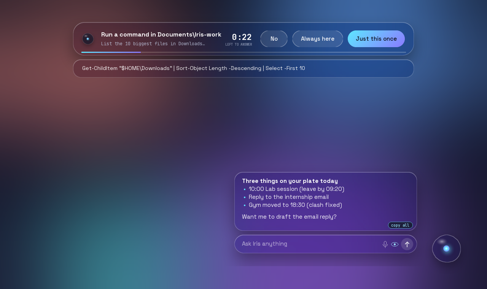
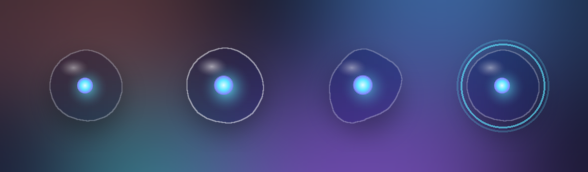
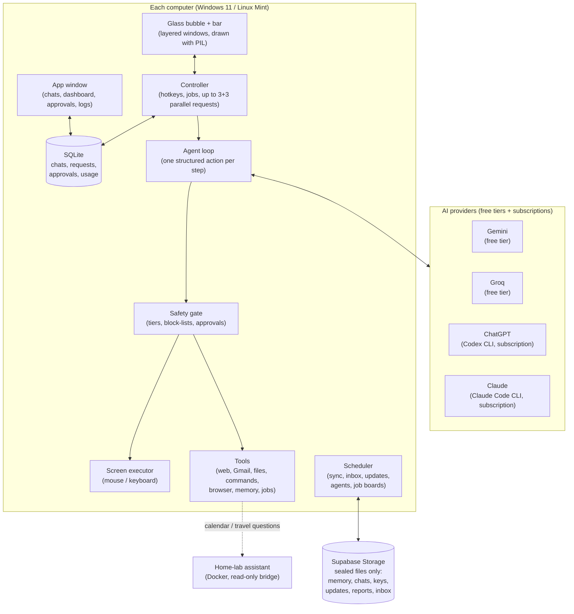
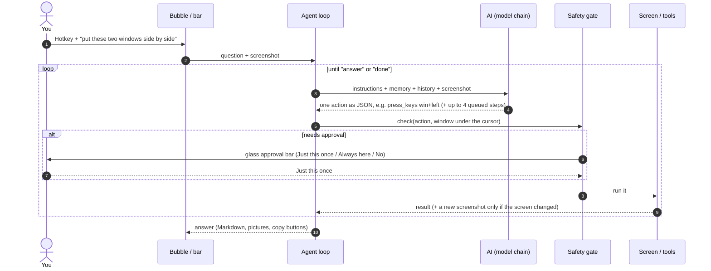
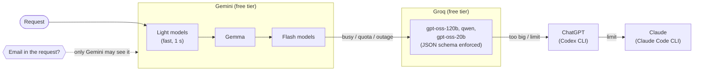
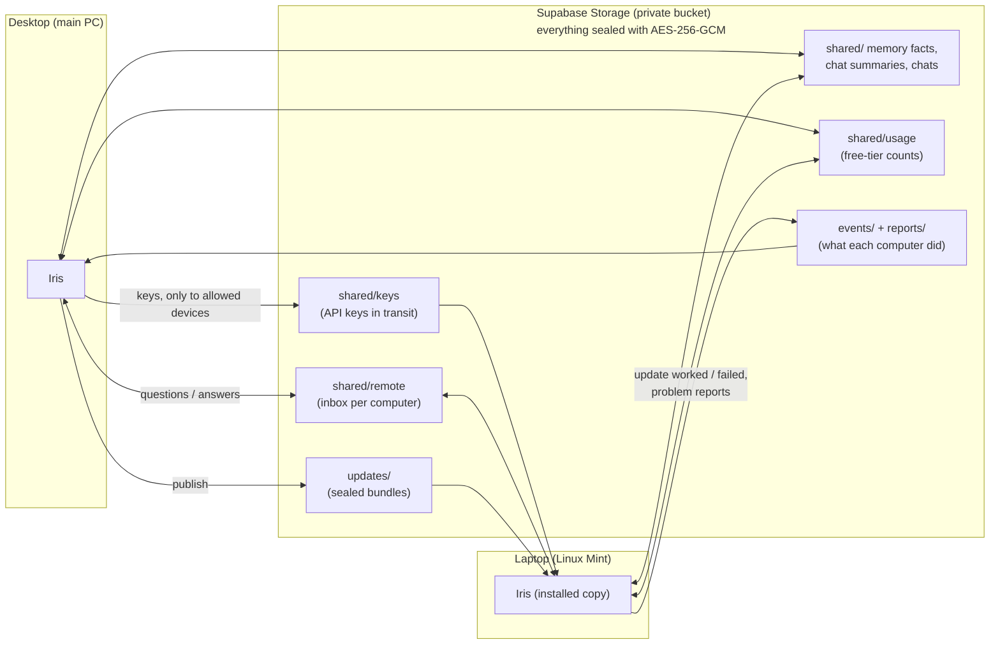
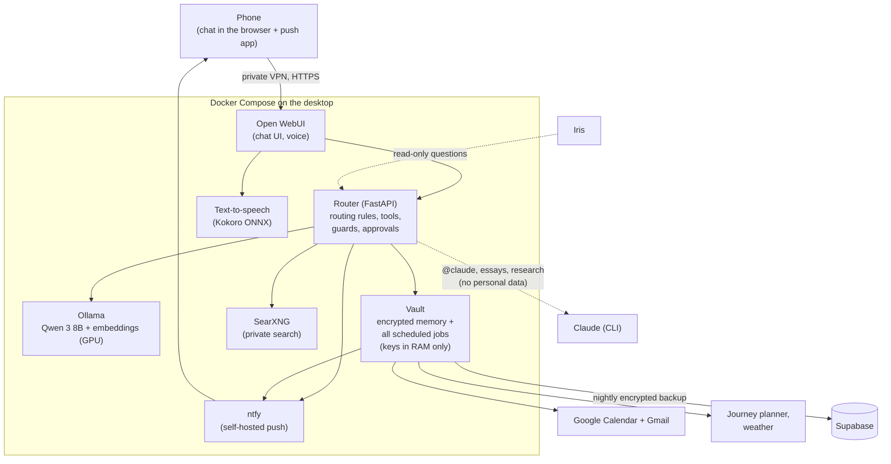

# Iris: a personal desktop AI agent (and the home-lab assistant behind it)

**Iris** is a desktop AI agent that lives on screen as a small glass bubble. You can ask it about whatever is on your screen, have it click and type for you, read your email, search the web, read your files, run commands in folders you allow, watch job boards, and remember things across your computers. Every action passes through one safety layer, and anything risky waits for your OK.

Iris runs on **Windows 11** and **Linux Mint**, it costs **nothing to run** (free AI tiers and existing subscriptions only), and it works next to a second system: a **home-lab assistant** in Docker that handles the calendar, travel and the phone.

> This repository is a **write-up of the architecture**: what was built, how the parts fit together, and what was learned. The source code itself stays private (it is wired to personal accounts), so there is very little code here, just diagrams and explanations.
>
> Built by **Terence**, designed and directed by him and written with [Claude Code](https://claude.com/claude-code), from October 2026.

| | Iris (desktop agent) | Home-lab assistant |
|---|---|---|
| Runs on | Windows 11 + Linux Mint (desktop + laptop) | Docker on the desktop (reachable from the phone over a private VPN) |
| Main job | See the screen, act on it, files, web, email, jobs | Calendar, travel times, reminders, email, phone pushes |
| AI | Gemini free tier → Groq → ChatGPT → Claude | Local Qwen 3 8B on the GPU; Claude only when asked |
| Size | ~33,000 lines of Python, 760 automated tests | Router + vault + 6 containers, ~230 tests |

---

## Contents
- [What Iris can do](#what-iris-can-do)
- [The big picture](#the-big-picture)
- [How one request flows](#how-one-request-flows)
- [Which AI answers](#which-ai-answers)
- [The safety layer](#the-safety-layer)
- [Several computers, one Iris](#several-computers-one-iris)
- [The home-lab assistant](#the-home-lab-assistant)
- Deeper pages: [Iris architecture](docs/iris-architecture.md) · [Home-lab assistant](docs/home-lab-assistant.md) · [Security and privacy](docs/security-and-privacy.md) · [Lessons learned](docs/lessons-learned.md) · [Timeline](docs/timeline.md)

---

## What Iris can do

*The bubble: idle, under the mouse, thinking (its outline morphs), and listening (rings follow your voice). The glass is real: it blurs a live capture of whatever is behind it.*

- **Ask about the screen.** A hotkey takes a screenshot of what you're looking at and opens the glass bar.
- **Do things on the screen.** It clicks, types, presses keys and scrolls in a checked loop: act, look again, decide the next step. It can queue up to 4 sure steps in one AI call to save time.
- **Talk.** Voice in (online transcription) and spoken answers (online voices). No local models, so it stays light on a laptop.
- **Email.** It searches and reads Gmail. Email content never goes to the third-party AIs.
- **Web.** It searches, reads pages and cites only the pages it actually read. A hidden background browser lets it browse without touching your screen.
- **Files and pictures.** It reads PDF, Word, Excel, text and code files, and can show pictures inside its replies.
- **Commands.** It runs PowerShell or bash commands in the background. A hard block-list applies even with approval, and you can say "always allow" for a folder.
- **Your own agents.** Scheduled tasks ("every weekday at 8, summarise my unread email"), each with its own chat.
- **Job watcher.** It checks UK job boards on a schedule, an AI scores the postings, and the best ones are pushed to the phone.
- **Memory.** It keeps facts and chat summaries, encrypted per row, shared across your computers.
- **One app window.** Chats, dashboard, agents, approvals, live command output, memory, logs and "report a problem".
- **Ask the other computer.** The laptop can ask the desktop (and back) through a sealed inbox.

---

## The big picture

Some design choices:
- **The AI never touches the machine directly.** It only proposes one structured action at a time (a JSON object checked against a schema). The safety gate checks it, may ask you, and only then does the executor or a tool run it.
- **One brain per computer.** The bubble, the app window and the scheduled agents all queue work into the same process, so there is one rate limiter, one safety layer and one approval queue.
- **Pure rendering.** Every glass surface is drawn as an image (PIL, then shown in a per-pixel-alpha window), so the same code can draw it on screen, render it in tests, or produce the pictures in this README.

More: [docs/iris-architecture.md](docs/iris-architecture.md)

---

## How one request flows

A plain question finishes at step 1 in about **1–1.5 s**. A screen task takes one AI call per look, and the loop waits for the screen to settle instead of sleeping a fixed time. If the same action keeps hitting the same screen, Iris notices it's stuck, asks a stronger model for advice, and after 150 s without progress stops and explains why.

---

## Which AI answers

- **Free tiers first, subscriptions last.** There are no pay-as-you-go API keys. ChatGPT and Claude are reached through their official command-line tools, signed in with the user's existing subscriptions, with their own tools switched off.
- **Each model has its own budget.** Daily and per-minute limits are counted per model and **shared across both computers**, so the laptop and desktop don't each think they have the full quota.
- **Outages are skipped fast.** A failing model rests for 30 s. If three Gemini models fail within 90 s, Gemini is skipped for 2 minutes. A broken reply gets one quick retry, then goes to a stronger model.
- **Strong models for writing.** Planning, getting unstuck and long write-ups go to the strong models, while the fast models do the gathering.

Measured speeds (in-process benchmark, real tasks): easy question **1–1.5 s** · code question **3–5 s** · web question **~6 s** · read and summarise a 41 KB file **~30 s** · multi-page research **37–52 s**.

---

## The safety layer

Every action goes through `SafetyGate.check()`. No code path skips it.

| Tier | Examples | What happens |
|---|---|---|
| 0: look only | answer, web search, read a page, read email, search memory | runs straight away |
| 1: screen | click, type, scroll, keys | the plan is approved **once per task**, then it runs |
| 2: commits | send email, run a command, submit/post, create an agent, change settings | **always** shown in full and approved |
| 3: refused | banking/password windows, admin windows, card numbers, `Win+R`, blocked commands | never, even if approved |

Some of the checks that don't trust the model:
- **Sensitive windows** (banking, password managers, secret files on screen) are never screenshotted or acted on.
- **Commands** have a hard block-list that applies even with approval: credential stores, keys, security settings, download-and-run, admin, services, disks, shutdown and more. They run without a window, with a stripped environment (no API keys) and a time limit, and the stop hotkey kills the whole process tree.
- **"Always allow here"** never covers deleting, your top-level personal folders, paths outside the folder, or a task that has just read web or email content (prompt injection).
- **Untrusted text** (web pages, email, files, other tools) is wrapped and marked. A small classifier model flags hidden-instruction attempts before the main model sees the text.
- **Sending email** needs a sending verb in your own request, an approval showing To/Subject/full body, and a single-use approval bound to that exact message.

More: [docs/security-and-privacy.md](docs/security-and-privacy.md)

---

## Several computers, one Iris

- **Shared memory and chats.** Each row is encrypted on the computer with its own key, and the ciphertext is copied as-is. Supabase only ever sees sealed blobs plus bookkeeping such as ids and dates.
- **Key sync.** The main PC hands API keys only to devices on its allow-list. A device is identified by its MAC address and computer name. A device that asks again for keys it already has, or uses a known name with a different fingerprint, is blocked. Delivered keys are deleted from Supabase as soon as they're picked up.
- **Self-update.** The main PC publishes a sealed bundle. Installed copies check every 30 minutes, verify the SHA-256, unpack the files, restart when idle, and report back whether the update worked.
- **Reports without USB sticks.** Each computer sends sealed problem reports (log, system facts, the request that went wrong) and events (updates, keys, devices) that the main PC can read.
- **Computers asking each other** (new). There is a sealed inbox per computer. The main PC only answers allowed devices, and the laptop only answers the main PC (pinned on first contact). The answering side may only look things up: no clicking, typing, commands or changes.

---

## The home-lab assistant

The older system runs **in Docker on the desktop**, and you reach it from the phone over a private VPN. It is the "life admin" half: calendar, travel, reminders, email, approvals with buttons on the phone. Iris can ask it read-only questions (calendar, timetable, travel), and it never changes anything.

What it does by itself: mirrors every calendar into the others, adds reminders, detects clashes **including travel time**, sends "leave by" pushes, moves flexible events (small moves with Undo, bigger ones ask first), adds bookings found in email, offers study slots before deadlines, sends a morning and evening digest with weather and line disruptions, and alerts on new important mail. Every email it sends waits for a tap on the phone showing the exact message.

More: [docs/home-lab-assistant.md](docs/home-lab-assistant.md)

---

## Stack

**Iris:** Python 3.12–3.14 · Tk + Win32 layered windows / GTK 3 on Linux (glass UI drawn with Pillow + NumPy) · pywebview (app window) · mss · PyAutoGUI / python-xlib · APScheduler · SQLite · Google Gen AI SDK · Groq (OpenAI-compatible API) · Codex CLI + Claude Code CLI · Playwright (hidden browser) · ddgs + trafilatura (web) · AES-GCM + Argon2id (`cryptography`) · Supabase Storage · edge-tts · pytest + ruff + mypy `--strict`.

**Home-lab assistant:** Docker Compose · FastAPI · Ollama (Qwen 3 8B, nomic-embed-text) · Open WebUI · Kokoro ONNX TTS · ntfy · SearXNG · Google Calendar/Gmail APIs · public journey-planner and weather APIs · Supabase (Postgres + Storage, encrypted rows only) · Tailscale.

## Status (October 2026)

Done: all of the above, used daily on a desktop and a laptop. Next: approvals for remote requests that show on **both** computers (whichever you answer first wins), approved commands on the other computer, and a fuller Liquid Glass design pass.

See [docs/timeline.md](docs/timeline.md) for how it was built, and [docs/lessons-learned.md](docs/lessons-learned.md) for the bugs that taught the most.
