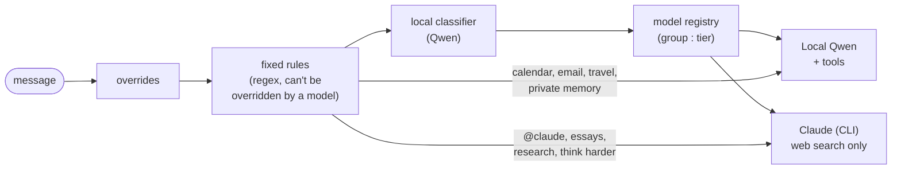
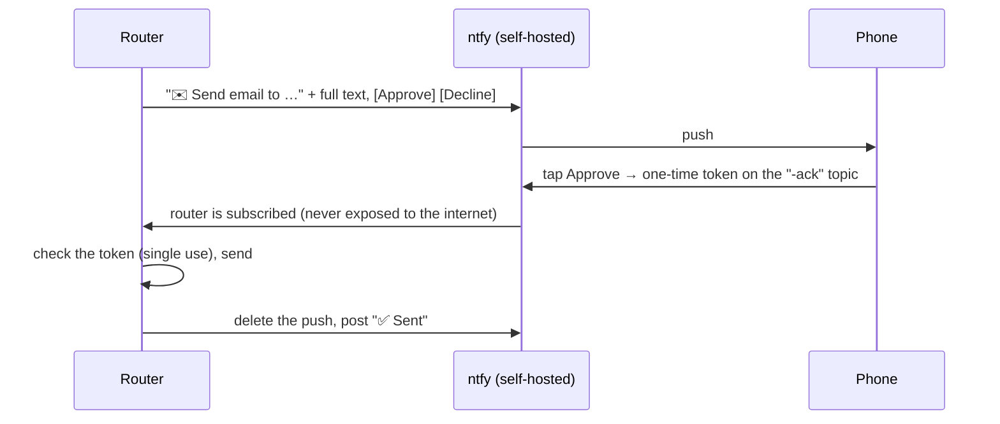

# The home-lab assistant

[← Back to the overview](../README.md)

The first of the two systems. It's a private assistant that runs entirely in **Docker on the desktop**, and you use it from the phone (over a private VPN, in the browser, with voice) or from the PC. Its job is "life admin": calendars, travel, reminders, email and approvals. It was built to move to an always-on, low-power home server later, so nothing in it depends on a Windows-only program except a small helper that unlocks it.

## Containers

| Service | What it does |
|---|---|
| **router** | FastAPI, OpenAI-compatible chat endpoint. Routing rules, tools, guards, approvals, phone pushes, monitoring |
| **vault** | Encrypted memory API **and every scheduled job**. Starts **locked**: its keys live in RAM only and arrive from a small helper on the host after login |
| **ollama** | Qwen 3 8B (no "thinking" mode) and an embedding model on the GPU, kept loaded (a cold load took ~70 s) |
| **open-webui** | Chat interface for phone and PC, voice mode |
| **tts** | Text-to-speech: Kokoro in ONNX (no PyTorch, ~0.4 GB of RAM instead of 1.5 GB) |
| **ntfy** | Self-hosted push server: approvals and alerts with buttons on the phone |
| **searxng** | Private meta-search for the web tool |

## Routing

- **Private data stays on the machine.** Calendar, email, travel and memory tools exist only on the local model. Email never goes to Claude, even when you write `@claude`.
- **What Claude gets.** Claude runs through its command-line tool with only web search and web fetch, and no shell, files or plugins. It receives the user's non-sensitive memories relevant to the question. Memories matching a sensitivity rule (credentials, finance, identity…) are withheld, and personal data in outside text (emails, phone numbers, card numbers) is masked before it's sent and unmasked in the reply.
- **Fallbacks.** Local → Claude light; Claude → local; offline → local. The footer says which model answered and why.

## Tools on the local model

Read calendar (titles and times; event details are marked untrusted) · add to calendar · travel plan · draft a "running late" message (never sent by itself) · search/read email (untrusted) · web search/fetch (untrusted, with protection against requests to internal addresses) · **send email** (always asks on the phone, showing the whole message).

Limits: 20 tool calls a minute, 60 outside calls an hour. "Hold patterns" stop replies that try to reveal secrets, switch off logging or widen permissions.

## What runs by itself (in the vault)

| Job | Every | What it does |
|---|---|---|
| calendar | 10 min | Mirrors every source into the others ("Synced from others" calendars). The university timetable is read-only |
| reminders | 10 min | Adds reminder levels by event type (exam, flight, dinner, lecture…). Asks about events with none |
| travel | 5 min | Clashes **including travel time**, automatic small moves with Undo, "leave by" pushes, line disruptions on the route |
| bookings | 15 min | Booking emails → asks to add them to the calendar (no duplicates) |
| mail | 30 min | One push listing new important unread mail |
| prep | 1 h | A deadline with no study time before it → offers two 2-hour slots |
| digest | 09:00 / 21:30 | Morning and evening summary with weather and disruptions |
| backup | 15 min / daily | Encrypted memory rows + nightly sealed archive of the chat app to Supabase |

Non-urgent pushes are **held** while you're in a fixed event (lecture, meeting) or asleep, and sent afterwards. A job failing 3, 12 or 48 times in a row sends an alert.

## Phone approvals

Held requests time out after 120 s (no answer means no). Repeated or forged taps get "Already handled".

## Memory and keys

- SQLite, with every content row encrypted with **AES-256-GCM**. The associated data `table|id|version` binds each row to where it belongs. Embeddings are stored encrypted and searched in RAM.
- The master key lives in the OS key store. A recovery file on a USB stick is protected with **Argon2id** (256 MiB, t=3, p=4) and a long passphrase.
- **Learning by itself.** After each reply, the local model extracts up to 3 lasting facts from *the user's own message only*, never from tool output, email or the web. A second pass asks "does the message plainly say this?" and drops guesses. Sensitive messages are never mined.

## How Iris uses it

Iris has one read-only action, `ask_assistant`: it sends a plain question to the router (on the same machine only), and every question is prefixed with "read-only, don't create, send, delete or change anything". The assistant's own approvals still guard any send. Its answers are treated like email on Iris's side, so they never reach the third-party AIs.
