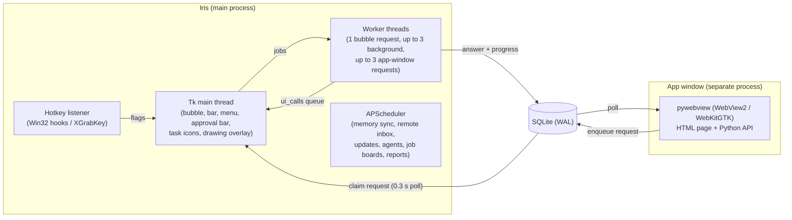
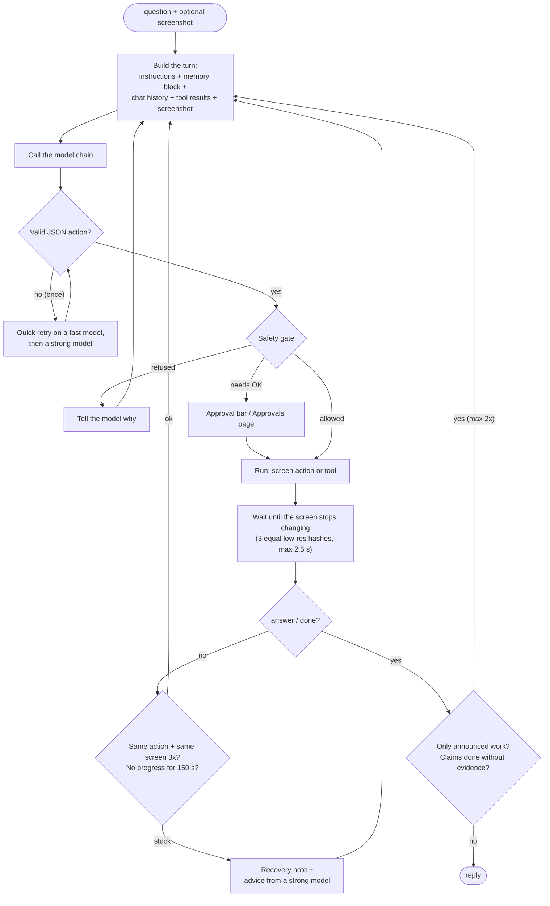
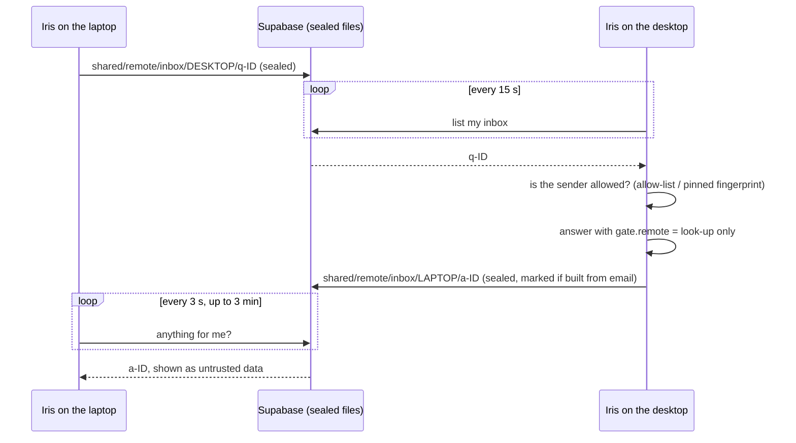

# Iris: architecture

[← Back to the overview](../README.md)

## Processes

- **The UI thread only draws.** Hotkeys set flags that the UI loop polls every 40 ms. AI calls run in worker threads, which reach the UI only through a queue.
- **The app window is a separate process**, so the web view gets its own main thread. It never answers anything itself: it writes a request row, and the running Iris claims it and answers. That way there is one brain, one rate limiter and one approval queue.
- **Requests run in parallel.** Each has its own stop flag, its own copy of the safety gate and tools, and its own model choice. Only **one** request may hold the mouse and keyboard at a time. A request that had to wait looks at the screen again before acting.

## The agent loop

Some details that made a difference:
- **One flat action schema.** The model fills one flat JSON object (`type` plus optional fields), which works well with Gemini's structured output. It is then checked against typed Python actions. Screen coordinates are 0–1000 of the screenshot, so they don't depend on resolution or DPI.
- **`then`: up to 4 screen actions in one call.** For example: press Win, type "notepad", Enter, type the text. Each queued step still goes through the gate. The queue stops if one needs approval, or if the window changed under a positioned click.
- **Screenshots only when needed.** Plain questions and tool steps don't take one. Screen steps take one after acting.
- **Tool results are kept whole.** Every result from the task stays visible: the newest in full, older ones trimmed, within a budget per model family. An early version dropped all but the last two, which made research answers incomplete.
- **A planner in the background.** For tasks, a strong model drafts a plan while the fast model starts acting, and the plan joins later turns.
- **The finishing check.** An "answer" that only says "I'll now create the file…" is sent back. That was the cause of "I had to ask it again and again".

## Glass UI

- **Layered windows** (Win32 `UpdateLayeredWindow`, per-pixel alpha) on Windows. On Linux, GTK 3 RGBA windows behind a Tk-like wrapper, with the input shape taken from the alpha channel so transparent pixels let clicks through.
- **Real blur.** Iris's own windows are excluded from screen capture, so it can grab what is *behind* the bubble, blur it and tint it. The backdrop is re-sampled every 0.7 s, or straight away when you switch windows, and old and new backdrops crossfade over 0.3 s.
- **Frame pacing follows the screen.** Animation frames match the monitor's refresh rate (30–240 Hz) but are never shorter than 3× the drawing time. The idle bubble breathes at 15 fps. On a slow laptop, a pre-rendered 21 s idle loop is replayed instead of drawing live.
- **Measured costs:** drawing a frame takes about 3 ms on the desktop. Converting a frame to premultiplied pixels moved to Pillow's C path (6.4 ms → 1.2 ms). Idle CPU dropped from 9 % to 4.7 % of a core.

## Data

| Store | What |
|---|---|
| SQLite (per computer) | conversations + messages, request queue, approvals, usage counts, command runs, job leads, agents, key/value settings |
| OS key store (Credential Manager / Secret Service) | API keys, the memory key, the Gmail refresh token |
| Supabase Storage (private bucket) | sealed copies only: memory, chats, usage, keys in transit, update bundles, events, problem reports, remote inbox |
| Logs | rotating app log (one writer per file), audit log (one JSON object per action) |

## Linux port

The code was written for Windows first, then ported "blind" (without a Linux machine to test on) and fixed using reports from the laptop:
- **Windows → Linux replacements:** layered windows → GTK; Win32 window info → python-xlib; keyboard hooks → `XGrabKey`; Credential Manager → Secret Service; Startup folder → `~/.config/autostart`; PowerShell → bash with its own block-list; toasts → `notify-send`.
- **Installers:** a USB installer for each OS. On a fresh computer it installs Python, creates a virtual environment, imports the keys from a passphrase-locked file, restores memory from Supabase, and adds shortcuts and autostart. After that, updates arrive over the network.
- **Packaging:** `Iris.exe` on Windows is the virtual environment's Python launcher with Iris's icon and version info, so Task Manager shows "Iris" instead of "pythonw".

## Remote questions between computers

Every file is deleted once it's read. A question also shows up in the app window on the answering computer, as a chat called "From <computer>".
