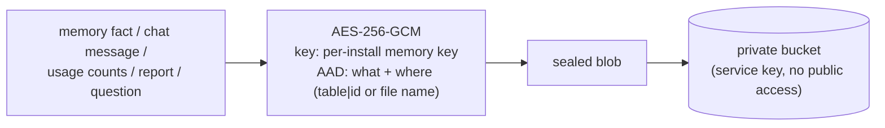

# Security and privacy

[← Back to the overview](../README.md)

Both systems run on hardware the owner controls, and the cloud is used only as storage for encrypted blobs. These are the rules that held throughout.

## Secrets
- API keys, tokens and encryption keys live **only in the operating system's key store** (Windows Credential Manager / Linux Secret Service), never in files, `.env`, logs or chat.
- Moving to a new computer uses a single file sealed with a passphrase (**Argon2id**, then AES-GCM). A key-sync channel then delivers keys **only to allowed devices**, and they're deleted from the cloud as soon as they're picked up.
- Some keys never leave the computer they were made on: the memory key, the Gmail token and the cloud login.

## Encryption at rest and in transit to the cloud

- **Bound to its place.** Associated data ties every blob to its own name, so a blob copied to another path won't decrypt.
- **What the cloud can see.** Only bookkeeping (ids, dates, which computer) is readable. A bucket audit found every file sealed.
- **Honest limit.** Anyone holding *both* the memory key and the cloud login could forge messages. Allow-lists and fingerprints stop other devices, not a full key compromise.

## What the AI providers see
- **Free-tier Gemini/Groq** see prompts and screenshots: an accepted trade-off for zero cost. A switch-off for data retention is used where the provider offers one.
- **Email never goes to Groq, ChatGPT or Claude.** The model chain checks every request for an email marker before choosing a provider. Answers from the other computer or the home-lab assistant that were built from email carry the same marker.
- **Never in front of the camera.** Windows showing secret files (keys, credentials, password databases) are never screenshotted. Iris's own windows are excluded from capture.

## Acting on the machine
- One gate, four tiers, deterministic checks (see the [overview](../README.md#the-safety-layer)).
- **Commands:** a block-list that applies even with approval, no admin, no service or scheduled-task changes, no download-and-run, a stripped environment, a time limit, below-normal priority, and a stop hotkey that kills the whole process tree. Output is checked for secrets before it's logged.
- **Prompt injection:** web pages, email, files and other tools' output are wrapped as untrusted, with fake closing tags neutralised. A small classifier model scores hidden-instruction attempts. A task that has read untrusted content loses "always allowed" shortcuts for commands.
- **Nobody watching:** scheduled agents and questions from another computer cannot run anything that needs an approval.
- **Never:** solving CAPTCHAs, typing passwords or card numbers, acting in banking or admin windows, sending without a visible approval of the exact message.

## Remote questions (computer to computer)
- The main PC answers only devices on its allow-list. Other computers answer only the main PC, pinning its fingerprint on first contact.
- The answering side may only look things up. A question asking it to "ask the other computer" is refused, so questions can't bounce back and forth.
- Questions and answers are sealed, deleted when read, and dropped after a day.
