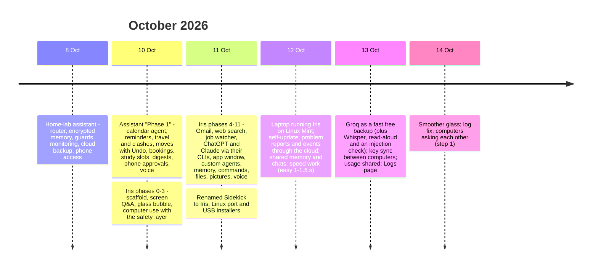

# Timeline

[← Back to the overview](../README.md)

Built in short, intense sessions with Claude Code. Each phase had acceptance criteria and had to pass its tests before the next phase started.

## Iris phases

| Phase | What |
|---|---|
| 0 | Scaffold: config, key store, typed and tested modules (ruff + mypy `--strict` + pytest) |
| 1 | Screen Q&A: hotkey → screenshot → answer |
| 2 / 2b | Conversation memory, the glass bubble |
| 3 | Computer use with the safety layer |
| 4 | Gmail (read; sending gated) |
| 5 | Web search with honest citations |
| 6 | Job watcher with AI scoring and phone alerts |
| 7 | ChatGPT / Claude subscriptions as fallbacks, through their CLIs |
| 8 | Polish: tray, autostart, single instance |
| 9 | The glass UI design: bubble, bar, approvals, app window |
| 10 | Custom scheduled agents |
| 11 | "Smarter": stronger models for tasks, long-term memory, cloud backup, drawing on screen |
| later | Commands, files, pictures, voice, Linux, installers, self-update, reports, Groq, key sync, remote questions |
